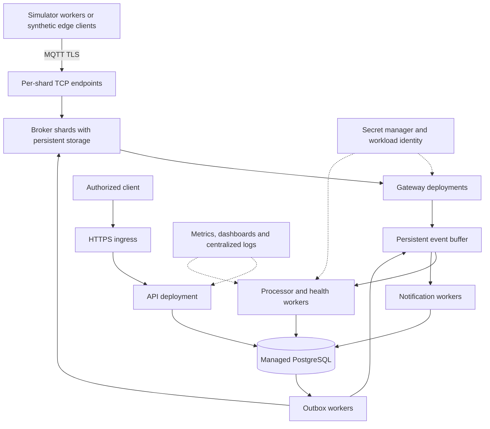

# Future cloud architecture

Status: design option only. No subscription, resources, infrastructure code, deployment, charges or cloud tests are authorized. The local platform must remain independently usable. Cloud feasibility, service availability, quotas and prices must be rechecked when deployment is requested.

## Portable baseline

This proposed deployment keeps the same event envelope, database invariants and API. Kubernetes runs stateless services across multiple nodes. Spread replicas across failure domains, enforce resource requests/limits and network policies, and add disruption budgets. Bound replicas by database connection capacity and broker/queue capacity; autoscaling does not create unlimited throughput.

Separate public ingress from private database, queue and administrative networks. Terminate MQTT device TLS at the broker so it can verify client certificates; do not replace device identity with an untrusted proxy header. Use HTTPS application ingress with OIDC, and private operator access for cluster administration.

Use managed PostgreSQL with tested backup/restore and an appropriate HA mode. Select a durable event buffer after testing its persistence and replay contract. Redis managed-service availability alone does not establish durable message retention: supported commands, fsync semantics, failover loss, cluster key placement and persistence must be checked. If unsuitable, choose an event log/queue adapter and update the delivery ADR before implementation.

## Concrete Azure reference mapping

Azure is a reference option because AKS appeared in the original objective; no Azure account is required for this design.

| Portable capability | Azure candidate | Decision required before use |
|---|---|---|
| Container orchestration | AKS | Region, node pools, zonal support, private access and quotas |
| Image registry | Azure Container Registry | ARM64/AMD64 images, access and retention |
| Relational database | Azure Database for PostgreSQL Flexible Server | Capacity, supported version, HA and restore objectives |
| Buffer/cache | Azure Managed Redis, or a separately designed durable queue | Streams/command compatibility, persistence and failure tests |
| Secrets | Key Vault with workload identity | Rotation, least privilege, certificate distribution |
| User identity | Microsoft Entra ID/OIDC | Issuer, audience, scopes and application registrations |
| Metrics and dashboards | Managed Prometheus and Grafana, or self-managed equivalents | Ingestion, retention and cost controls |
| Backup/archive | Blob Storage | Access, retention, restore and deletion policies |
| Routing | TCP load-balancing endpoints and HTTPS ingress | Per-shard routing, certificates and exposure |

These are proposed mappings, not a claim that a particular SKU meets the workload. The [AKS baseline](https://learn.microsoft.com/en-us/azure/architecture/reference-architectures/containers/aks/baseline-aks) provides the reference security and network context. Prefer evaluating Azure Managed Redis over starting a design on the retiring Azure Cache for Redis product; check the [official retirement guidance](https://learn.microsoft.com/en-us/azure/azure-cache-for-redis/retirement-faq) at implementation time.

## Optional IoT Hub transport

IoT Hub is an alternative ingress design, not a DNS change for Mosquitto. It has prescribed MQTT topics and authentication behavior. See [MQTT support](https://learn.microsoft.com/azure/iot-hub/iot-hub-mqtt-support).

A future adapter would map the simulator's canonical envelope to IoT Hub device-to-cloud messages, consume routed events through the chosen service endpoint, and attach trusted device identity metadata before the existing processor boundary. It must also map application commit receipts to a supported downstream mechanism. That receipt path has its own quotas and latency; the local per-event receipt design cannot simply be assumed affordable or feasible in IoT Hub.

Preserve `event_id`, device ID, boot identity and sequence through the adapter. Checkpoint only after durable handoff. Registration would reconcile the registry with the cloud device identity service, with explicit provisioning/disable states and audit trails. Validate the supported X.509 provisioning mode. Do not promise local MQTT retained status, shared subscriptions or will behavior in this option; heartbeat expiry remains the portable health signal.

At 50,000 devices and one heartbeat every 30 seconds there are 144 million heartbeat events/day, before telemetry, diagnostics, reconnects and receipts. Capacity planning must include connection rate, message metering size, routing and downstream limits. Consult [IoT Hub quotas](https://learn.microsoft.com/en-us/azure/iot-hub/iot-hub-devguide-quotas-throttling). No free tier is assumed to support this experiment.

## Availability and disaster recovery

A multi-node broker deployment is still sharded unless a broker with verified replication is selected. A single persistent shard on zonal storage may be unavailable during that zone's outage. Do not label this Mosquitto design highly available across zones. A stricter availability goal requires a replicated broker decision or managed ingress adapter and corresponding fault tests.

Proposed future database disaster-recovery targets: recovery point no older than 15 minutes and service restoration within 60 minutes, subject to measured restore drills and selected service capabilities. These are design goals, not cloud SLAs. Cross-region replication and active-active operation are out of the baseline.

## Migration and authorization gates

1. Obtain separate permission to implement cloud support and a cost ceiling; select provider, region and retention policy.
2. Recheck service support, quotas, identities, networking and monthly cost estimates, including idle nodes, storage, logs, egress and backups. Budget alerts are not hard spending caps.
3. Produce reviewable infrastructure code and a deployment plan. Obtain explicit permission before resource creation.
4. Deploy only a small isolated synthetic environment; run contract and failure tests against it. No production traffic exists to migrate.
5. Move a small simulator cohort using a versioned assignment, keeping event IDs stable. Reconcile event counts and health transitions before increasing load.
6. Roll back by stopping the cohort, restoring its local assignment and replaying uncommitted data. If databases diverge, reconcile by immutable event identity before switching queries; do not silently dual-write.
7. Export required evidence, then explicitly tear down approved resources and verify residual storage/backup charges.
