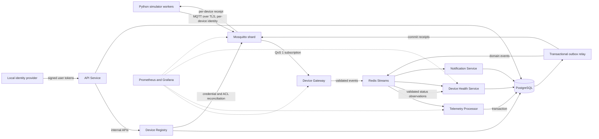

# Local architecture

Status: proposed design, not an implemented or benchmarked system. The local deployment is the first implementation target. Design choices are recorded in [ADR-0001](../decisions/0001-platform-boundaries.md).

## System flow

The outbox relay is a worker role of the owning service, not another independent domain service. Health writes its own outbox records, which produce notification requests. No external email or messaging is part of the initial demonstration.

## Responsibilities and ownership

| Component | Responsibility | Persistent state and scaling |
|---|---|---|
| Simulator | Synthetic state, paced publishes, reconnection, bounded replay | Per-worker disk spool; disjoint device ranges; scale workers |
| Mosquitto | TLS client authentication, per-device topic authorization, sessions, wills | One persistent volume per shard; no automatic cross-shard session replication |
| Device Gateway | Validate topic/payload identity, size, schema and active registration; attach trusted ingress metadata | Stateless workers; bounded registry cache and MQTT in-flight work |
| Device Registry | Register/disable devices; record certificates, provisioning status and audit history | Registry schema; replicated API and single leased reconciliation job |
| Telemetry Processor | Idempotent event storage and transactional outbox creation | Telemetry schema; Redis consumer-group workers |
| Device Health Service | Last-seen, stale connectivity, battery and diagnostic state transitions | Health schema; event consumers and leased timeout sweeper |
| Notification Service | Open, suppress, acknowledge and resolve operational incidents | Notification schema; idempotent consumers |
| API Service | Authorize human/application access; present device and fleet information | Read-only database views plus internal mutation APIs; stateless |
| Local identity provider | Issue signed tokens for test users and application clients | Local Keycloak candidate, activated in the authorization stage |
| PostgreSQL | Authoritative application records, deduplication and outboxes | Single instance locally; backup and restore required |
| Redis | Buffer work and track consumer progress | Persistent streams, no cache eviction; not authoritative device history |

Service-specific database roles own separate schemas in one local PostgreSQL instance. Cross-service writes are prohibited; API mutations go to the owning service. Read-only views are an intentional portfolio simplification, versioned with migrations.

## Deployment profiles

1. **Smoke:** Compose, 100 devices, one broker, one instance of each service. Verify the complete path before scale.
2. **Local demonstration:** Compose, 1,000 devices by default, adjustable publishing intervals. PostgreSQL, Redis, MQTT, Prometheus and Grafana remain on isolated container networks.
3. **Kubernetes demonstration:** A kind cluster inside Docker Desktop, with the same containers and contracts. Start with one node; use additional local nodes only for scheduler experiments. They still share one physical host and do not demonstrate availability-zone resilience.
4. **Capacity experiments:** 5,000, 25,000 and 50,000 devices, explicitly distinguishing real connections from identity-only multiplexing. Run one profile at a time. Stop when memory, file descriptors, disk, ports or queue limits require it.

The inspected host has 16 GiB RAM and 10 logical CPUs. Docker was allocated about 7.75 GiB. These are environmental observations, not resource guarantees. Proposed initial memory ceilings: PostgreSQL 1 GiB; Redis 512 MiB with a smaller internal maxmemory; broker 512 MiB; combined services 1.5 GiB; observability 1 GiB; identity provider 512 MiB; simulator 512 MiB. Leave headroom for Docker and measure before increasing load. Do not assume these ceilings support 50,000 TLS connections.

Use ARM64-capable images on this Mac. Pin tested runtime versions and image digests during implementation; host CLI versions do not determine container versions. Native Mosquitto/Redis utilities are debugging tools; do not start duplicate host daemons.

## Network and scaling boundaries

Only the MQTT TLS listener and required web interfaces bind to loopback on the host. Database, Redis, metrics and administrative endpoints remain internal. MQTT uses TCP/TLS, not an HTTP ingress route. Certificates must contain the broker hostname used by clients.

Start with one broker. For experiments, assign devices to explicitly named shards through a versioned assignment manifest. Gateways subscribe to each assigned shard. Scale gateway consumers using a shared subscription only after testing its queue/session behavior with the pinned broker; it is not a durability guarantee. Do not add gateway consumers through ordinary identical wildcard subscriptions, which would multiply delivery.

Broker failover initially means restarting the same shard with its volume and replaying uncommitted events. Moving devices to another shard needs an explicit assignment change, reconnect and replay. It does not recover that shard's subscriptions or retained state automatically.

[Kind documentation](https://kind.sigs.k8s.io/docs/user/quick-start/) explains its container-based local cluster model. [Mosquitto configuration](https://mosquitto.org/man/mosquitto-conf-5.html) is the basis for the TLS, ACL and persistence settings to validate later.
