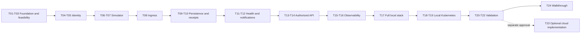

# Stage 2 plan: medical IoT platform

## Approval and scope

The user approved Stage 2 documentation including both local and future cloud architecture. The user subsequently approved Stage 3: the Python foundation, shared event validation and a bounded local MQTT test harness. Cloud resources and Stage 4 onward remain unapproved. Each later stage requires a concrete action summary and explicit permission before execution. Stage 1 environment/repository work is complete.

The [task checklist](todo.md) holds implementation tasks; T01–T03 are complete with evidence; subsequent tasks remain unchecked. Technical specifications live under [docs](../README.md). Defaults and SLOs are proposals, not measured capabilities.

## Intended stages, reasons and tools

| Stage | Intended action and reason | Tools / deliverable | Approval status |
|---|---|---|---|
| 1 | Establish correct folder, public repositories and local tools so work is reproducible | Git/GitHub, Homebrew, Docker; completed setup | Completed |
| 2 | Define boundaries, contracts, risks and tests before coding | Markdown, Mermaid, official documentation, ADRs | Authorized documentation only |
| 3 | Establish reproducible Python/service structure and an MQTT-client feasibility spike to expose scaling risks early | uv, Python, FastAPI, Pydantic, Paho, pytest, Ruff; T01–T03 | Completed locally; see evidence |
| 4 | Create identity and certificate lifecycle so devices can be isolated and disabled | PostgreSQL, Alembic, local CA, Mosquitto ACLs; T04–T05 | Await permission |
| 5 | Build deterministic simulator and spool so tests can reproduce loss/reconnect cases | Python async event loop, seeded scenarios, local disk spool; T06–T07 | Await permission |
| 6 | Connect validated MQTT ingress to bounded asynchronous work | Gateway, Mosquitto, Redis Streams; T08 | Await permission |
| 7 | Persist telemetry idempotently and issue receipts so recovery can be accounted for | PostgreSQL transactions/outbox, processor; T09–T10 | Await permission |
| 8 | Turn telemetry into actionable state and deduplicated incidents | Health and Notification services; T11–T12 | Await permission |
| 9 | Expose authorized queries and administration | FastAPI/OpenAPI, local OIDC, role checks; T13–T14 | Await permission |
| 10 | Add metrics and dashboards so bottlenecks and recovery are visible | Prometheus, Grafana, structured logging; T15–T16 | Await permission |
| 11 | Package the complete repeatable local demonstration | Docker Compose, pinned images, local-only ports; T17 | Await permission |
| 12 | Demonstrate scheduling and horizontal scaling locally | kind, Helm, Kubernetes probes/resources, metrics adapter where justified; T18–T19 | Await permission |
| 13 | Measure correctness, scale, security and failure recovery | Focused tests, load profiles, fault injection, restore drills; T20–T22 | Await permission |
| 14 | Optionally implement and validate cloud support after a separate decision | Cloud adapter/IaC only after provider, costs and permissions are agreed; T23 | Deferred; not authorized |
| 15 | Publish an accurate walkthrough and operational guide | Documentation, sanitized evidence and demo script; T24 | Await permission |

A small test-only dependency harness may be added in an approved early implementation stage; the full user-facing Compose stack remains Stage 11. This avoids pretending integration tests can run without their dependencies.

## Dependency graph

Checkpoints follow each meaningful slice. Stage boundaries are permission gates even if dependencies are already satisfied. No stage automatically authorizes the next.

## Risks and mitigations

| Risk | Effect | Planned response |
|---|---|---|
| 50,000 TLS connections exceed this PC | Scale target cannot be demonstrated locally | Early client spike, stepped runs, resource evidence; never extrapolate success |
| Thread per simulated device | Scheduler/memory exhaustion | Shared external event loop; measure before committing to client choice |
| ACK before durable application commit | Silent loss across failures | Bounded source spool, commit receipts, idempotent transaction/outbox |
| Broker replicas mistaken for HA | Incorrect recovery claims | Explicit sharding and documented failure boundary |
| Buffer and history growth | Memory/disk exhaustion | Limits, noeviction, safe trimming, retention and stop thresholds |
| Replay incorrectly revives offline devices | Misleading fleet health | Freshness and monotonic ordering rules |
| Certificate revocation leaves active connections | Disabled devices still publish | Reconciliation plus explicit disconnect or controlled shard restart |
| Cloud design becomes accidental deployment | Cost or scope violation | Separate implementation and deployment approvals |

## Open decisions for the relevant implementation stage

- Confirm proposed SLOs, retention and storage ceilings before coding their policy.
- Pin compatible Python, broker, Redis, PostgreSQL and container versions after verification.
- Validate Paho event-loop integration and manual ACK behavior before committing to high-scale mode.
- Choose whether to add Loki within the available memory; metrics remain Prometheus/Grafana.
- Confirm Kubernetes metrics adapter versus KEDA only when backlog-based autoscaling is implemented.
- Choose cloud provider/region, buffer and broker availability model only if future cloud work is authorized.

These decisions do not block the Stage 2 design package. They explicitly block claims about implementation or capacity until resolved and tested.
